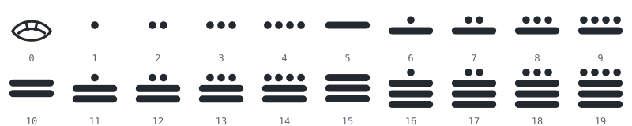

# mayan-numerals

Render any number as [Maya numerals](https://en.wikipedia.org/wiki/Maya_numerals): SVG with zero dependencies, plus PNG, JPEG and WebP through [sharp](https://sharp.pixelplumbing.com/).

**[Docs and playground](https://karlnorling.github.io/mayan-numerals/)** · [Storybook](https://karlnorling.github.io/mayan-numerals/storybook/)

| Package                                                     | What it does                                     |
| ----------------------------------------------------------- | ------------------------------------------------ |
| [`@mayan-numerals/core`](packages/@mayan-numerals/core)     | Numbers to SVG. No dependencies, runs anywhere.  |
| [`@mayan-numerals/raster`](packages/@mayan-numerals/raster) | Numbers to PNG, JPEG or WebP in Node, via sharp. |
| [`@mayan-numerals/cli`](packages/@mayan-numerals/cli)       | The `mayan` command.                             |

<p>
  
  
  
  
</p>
<p>
  
  
</p>

The Maya wrote numbers with three signs: a dot for one, a bar for five and a shell for zero. One level holds a digit from 0 to 19, and levels stack upwards, each worth twenty times the one below. The shell made it a true positional system with a zero, centuries before zero reached Europe.



## Usage

```sh
npm install @mayan-numerals/core
```

```js
import { toSvg } from '@mayan-numerals/core';

const svg = toSvg(1993);
const red = toSvg(1993, { size: 200, color: '#c00', background: 'white' });
```

```sh
npm install @mayan-numerals/raster
```

```js
import { toImage } from '@mayan-numerals/raster';
import { writeFile } from 'node:fs/promises';

await writeFile('1993.webp', await toImage(1993, { format: 'webp', size: 400 }));
```

### Command line

```sh
npx @mayan-numerals/cli 1993 > 1993.svg
npx @mayan-numerals/cli 3.14159 -o pi.webp --size 200
npx @mayan-numerals/cli -42 -o minus.png
```

Installed globally (`npm install -g @mayan-numerals/cli`), the command is `mayan`. Run `mayan --help` for every option.

### Colours and gradients

`color` and `background` take any CSS colour, or a CSS gradient: `linear-gradient()`, `radial-gradient()` and their `repeating-` forms. A gradient spans the whole image.

```js
// Rainbow
toSvg('123456789', {
  color:
    'linear-gradient(to bottom, #e03131, #f76707, #fab005, #40c057, #228be6, #7048e8, #be4bdb)',
});

// Christmas
toSvg('2026.1225', {
  color: 'repeating-linear-gradient(135deg, #e03131 0 3%, #ffffff 3% 6%)',
  background: 'radial-gradient(#2b8a3e, #0b3d20)',
});
```

## Numbers the Maya didn't write

Maya numerals are positional, in base 20, with a zero, so whole numbers of any size need no extension. This library adds fractions and negatives:

| Input  | Drawn as               | Rule                                                                                   |
| ------ | ---------------------- | -------------------------------------------------------------------------------------- |
| `0`    | a shell                | The historical sign for zero.                                                          |
| `400`  | 1, shell, shell        | Levels are worth 1, 20, 400, 8000 and so on, top level first.                          |
| `12.5` | 12, a dashed line, 10  | Fractions continue below a dashed line, each level worth a twentieth of the one above. |
| `0.01` | 0, a dashed line, 0, 4 | Every decimal fraction is exact in base 20, so nothing is rounded.                     |
| `-7`   | 7 with a minus mark    | A short line beside the top level.                                                     |

The Long Count calendar counted 18 instead of 20 in its third place, so that place was worth 360 days. This library draws pure base 20. Fractions and the minus mark are modern additions; the Maya didn't use them.

Inputs can be a `number`, a `bigint` or a decimal `string`. A number is first written in its shortest exact form, so `0.1` draws as `0.1`. Strings and bigints keep every digit.

## API

### `toSvg(value, options?)` → `string` from `@mayan-numerals/core`

| Option       | Default        | Notes                                                                |
| ------------ | -------------- | -------------------------------------------------------------------- |
| `size`       | `100`          | Image width in pixels. The height follows from the number of levels. |
| `color`      | `currentColor` | Colour of the dots, bars and shells. Takes a colour or a gradient.   |
| `background` | none           | Colour or gradient behind the numeral.                               |
| `gap`        | `24`           | Space between levels, in viewBox units.                              |
| `padding`    | `10`           | Space around the numeral, in viewBox units.                          |
| `title`      | the number     | Accessible name. `false` leaves it out and sets `aria-hidden`.       |

### `toImage(value, options?)` → `Promise<Buffer>` from `@mayan-numerals/raster`

Takes every `toSvg` option, plus `format` (`png`, `jpeg`, `jpg` or `webp`; default `png`) and `quality` (1–100). Colours default to black. JPEG gets a white background unless you pass one.

### Lower level, from `@mayan-numerals/core`

- `parse(value)` → `{ negative, integer, fraction }`: the base-20 digits that get drawn.
- `format(parsed)` → the canonical decimal string, e.g. `-12.5`.
- `digitSvg(digit, place?, options?)` → one digit on its own.
- `parseGradient(css)` → the object form of a CSS gradient string, or `undefined` for a plain colour.
- `digitShapes(digit)` → the bars, dots or shell of one digit, for drawing somewhere else.

## Development

```sh
yarn install
yarn test        # all packages, straight from source
yarn build       # core, then raster, then cli
yarn docs        # docs site with the playground, on localhost:4322
yarn storybook   # Storybook on localhost:6006
yarn examples    # regenerate examples/
```

## License

MIT
